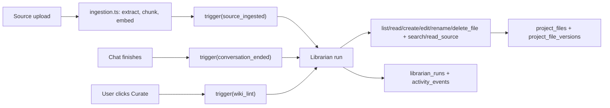

## Problem

Today the wiki layer is a brittle mix of one narrow LLM call plus deterministic file-pokes:

- [src/lib/server/ingestion.ts](src/lib/server/ingestion.ts) `runWikiSynthesis` emits a fixed JSON shape, then code string-replaces into `decisions.md` (`.replace("_No decisions recorded yet._\n", "")`), appends to a hardcoded daily memory file, and tacks a line onto `index.md`.
- [src/lib/server/memory.ts](src/lib/server/memory.ts) writes `memory-YYYY-MM-DD.md` while [src/lib/server/chat-context.ts](src/lib/server/chat-context.ts) reads `memory/%` — the two disagree.
- [src/app/api/chat/route.ts](src/app/api/chat/route.ts) `edit_file` tool adds its own `"(summary pending)"` stub to `index.md`.
- The "wiki lint" is just prose in the system prompt; there is no dedicated workflow, no file deletion or renaming, and no background execution.

The agent can't create entity pages, split topics, rename files, or delete stale content — because the code decides what happens, not the agent.

## Shape of the fix

Introduce a dedicated **Librarian** agent that owns the wiki layer. It is invoked from three triggers (ingestion done, chat ended, user-requested lint), runs in the background, has full wiki CRUD, and logs everything it does.




## 1. New module: the Librarian agent

Create `src/lib/server/librarian/`:

- `agent.ts` — single entry `runLibrarian({ projectId, userId, trigger, context })`. Uses `streamText` (or `generateText`) from the AI SDK with its own system prompt. The system prompt is assembled from: `project_settings`, current `index.md`, `glossary.md`, trigger type, and trigger-specific context (e.g. the newly ingested source's title/summary/excerpt, or the conversation transcript, or "lint" instructions). It is not a chat thread — each run is a single autonomous turn with `stopWhen: stepCountIs(N)` style loop so it can chain tool calls.
- `tools.ts` — shared tools the Librarian uses. Richer than the chat agent's set:

```ts
list_files, read_file           // existing semantics
search_sources, read_source     // existing semantics
create_file({ path, content })  // explicit create, rejects if exists
edit_file({ path, content })    // rejects locked files
rename_file({ from, to })       // moves a file, preserves version history
delete_file({ path, reason })   // soft-delete; rejects locked/source-of-truth
```

Locked and source-of-truth guardrails are enforced in the tools, not the prompt. `is_source_of_truth === true` requires an additional `confirm: true` argument from the agent (the prompt explains this) or the tool refuses — this keeps brittle overwrites from happening silently.

- `triggers.ts` — three thin helpers:
  - `triggerOnSourceIngested(projectId, sourceId)` — pulls the source's title/summary/first chunk and calls `runLibrarian`.
  - `triggerOnConversationEnded(projectId, conversationId)` — pulls the transcript and calls `runLibrarian`.
  - `triggerWikiLint(projectId, userFocus?)` — calls `runLibrarian` with no source/chat context, just the lint directive.

## 2. Remove the deterministic wiki logic

- Delete `runWikiSynthesis` from [src/lib/server/ingestion.ts](src/lib/server/ingestion.ts). `ingestSourceMaterial` ends with `triggerOnSourceIngested(...)` instead.
- Delete `appendMemoryEntry` and `generateConversationMemory` from [src/lib/server/memory.ts](src/lib/server/memory.ts). Memory files are now written by the Librarian via `edit_file` / `create_file`, same as any other wiki page.
- Remove the `index.md` sidecar append inside the `edit_file` tool in [src/app/api/chat/route.ts](src/app/api/chat/route.ts) — the Librarian owns `index.md`. Index drift is fixed at the next Librarian run, not on every chat-driven edit.
- In [src/lib/server/chat-context.ts](src/lib/server/chat-context.ts), drop the "Wiki Lint" instructions block from the chat system prompt and align memory reads to `memory/YYYY-MM-DD.md` (the Librarian writes to the spec path; chat reads from it).

## 3. Wire triggers to on-demand background execution

Use Vercel's `after()` from `next/server` (a.k.a. `waitUntil`) so the request returns immediately and the Librarian runs on the same invocation in the background. No cron, no queue — this matches the "on-demand only" requirement.

- [src/app/api/sources/upload/route.ts](src/app/api/sources/upload/route.ts): after `ingestSourceMaterial` succeeds, call `after(() => triggerOnSourceIngested(...))`.
- [src/app/api/chat/route.ts](src/app/api/chat/route.ts): in `onFinish`, replace the `generateConversationMemory` call with `after(() => triggerOnConversationEnded(...))`. Drop the `MEMORY_TOKEN_THRESHOLD` heuristic — the Librarian decides whether a memory entry is worth writing.
- Replace [src/app/api/projects/[projectId]/memory/route.ts](src/app/api/projects/[projectId]/memory/route.ts) with a more general `POST /api/projects/[projectId]/librarian` that accepts `{ trigger: "conversation" | "lint", ... }`. The UI's existing "save memory" button points at `trigger: "conversation"`; a new "Curate wiki" button points at `trigger: "lint"`.

## 4. Data model additions

Two small migrations:

- `librarian_runs` table: `id, project_id, trigger_type, trigger_ref, status (running|succeeded|failed), summary, error, started_at, finished_at`. Each run writes one row; the UI can surface "Librarian ran after ingesting X, updated 3 files, created 1".
- `project_files`: add a partial unique index on `(project_id, path) WHERE deleted_at IS NULL` plus a `deleted_at timestamptz` column, so `delete_file` is a soft delete (reversible via version history, respects the spec's "undo safety net"). Update [src/lib/server/project-files.ts](src/lib/server/project-files.ts) `editProjectFile` and the list/read queries to filter `deleted_at IS NULL`.

## 5. Navigation and activity files the Librarian itself reads

Two files inspired by [docs/LLM wiki.md](docs/LLM%20wiki.md) that the Librarian treats as its working memory, in addition to the `project_settings` context:

- `index.md` — content-oriented catalog, already in the spec. The Librarian reads it at the start of every run to know what exists before deciding what to touch, and is the canonical author of updates to it (no more `(summary pending)` side-appends).
- `log.md` — **new default file**, chronological and append-only, owned by the Librarian. One entry per Librarian run with a consistent prefix, e.g.:
  ```
  ## [2026-04-18 14:03] ingest | spec.pdf
  Added 3 decisions, created stakeholders/samsung-design-team.md, touched index.md.

  ## [2026-04-18 15:22] lint | user-requested
  Flagged 2 stale claims in PROJECT.md; 1 orphan (old-brief.md); suggested follow-up questions: ...
  ```
  Seed it in [src/lib/server/project-setup.ts](src/lib/server/project-setup.ts) as `internal` visibility. The Librarian reads it at the start of each run (to avoid repeating work and to reference recent changes) and appends one entry before returning. `librarian_runs` remains the structured/DB record; `log.md` is the in-context surface the agent actually sees.

## 6. Step budget and cascading updates

A single source can legitimately require 10–15 page edits (update entity pages, revise topic summaries, flag contradictions, refresh `index.md`, append to `log.md`). Configure the run with a generous budget — `stopWhen: stepCountIs(40)` as a starting point — and rely on the tools' idempotency (always re-read `index.md` and the target file before writing) rather than on a tight step cap. Tune down once we observe real runs.

## 7. Promote chat explorations into wiki pages

`triggerOnConversationEnded` does more than write a memory entry. The Librarian's system prompt for this trigger instructs it to decide, per conversation, whether the conversation produced:

- **Session notes only** → append to `memory/YYYY-MM-DD.md` (the current behaviour).
- **A reusable artifact** (a comparison, an analysis, a synthesis, a stakeholder profile the user built up with the chat agent) → *also* promote it as a new wiki page under a logical prefix (`analyses/`, `stakeholders/`, etc.) and cross-reference it from `index.md`.

This matches the LLM-wiki doc's "good answers filed back into the wiki" principle and is why the trigger needs `create_file` / `rename_file` authority, not just `edit_file`.

## 8. Lint returns suggestions, not only a health report

The `triggerWikiLint` run produces two outputs:

- **Fixes it made or proposes** (contradictions, stale content, orphans, missing entity pages, index gaps) — same as the spec.
- **Forward-looking suggestions** — questions worth investigating next, source types that would fill detected gaps. These are surfaced as a structured list in the `librarian_runs.summary` / a distinct `activity_events.event_type = "librarian_suggestion"` so the UI can render them as actionable cards ("Ask: ...", "Upload: ..."). They are never auto-written to files.

## 9. Settings-driven autonomy (reuse what exists)

The agent permissions already in `project_settings` map cleanly:

- `auto_synthesize_on_ingest = false` → `triggerOnSourceIngested` becomes "queue a proposal" instead of running writes (Librarian runs in a proposal-only mode that only calls read tools and returns a plan surfaced to the user).
- `auto_create_entity_pages = false` → `create_file` rejects paths under `stakeholders/` (or other entity prefixes) unless the trigger is a user-initiated lint.
- `proactivity = reactive` → the Librarian runs as proposal-only for all triggers except `lint`.

## 10. Observability

- Every tool invocation inside a run writes an `activity_events` row tagged with the `librarian_runs.id` in its metadata (`event_type: "librarian_file_edit" | "librarian_file_create" | "librarian_file_delete" | "librarian_file_rename"`). The existing [src/app/api/files/route.ts](src/app/api/files/route.ts) surface can render them grouped by run.
- `librarian_runs.summary` is written at the end of the run from the agent's final text output — a one-liner ("After ingesting `spec.pdf`: added 3 decisions to decisions.md, created stakeholders/samsung-design-team.md, updated index.md").

## 11. What we intentionally defer

- No scheduled/cron curation pass (confirmed not wanted).
- No external queue; `after()` is sufficient because runs are short and idempotent-by-design (the Librarian always re-reads `index.md` before writing).
- No streaming of Librarian progress to the UI in this pass — the `librarian_runs` row plus activity events are enough to show state.

## Files touched (summary)

- New: `src/lib/server/librarian/{agent,tools,triggers}.ts`, `src/app/api/projects/[projectId]/librarian/route.ts`, two Supabase migrations.
- Modified: [src/lib/server/ingestion.ts](src/lib/server/ingestion.ts), [src/lib/server/project-files.ts](src/lib/server/project-files.ts), [src/lib/server/chat-context.ts](src/lib/server/chat-context.ts), [src/lib/server/project-setup.ts](src/lib/server/project-setup.ts) (seed `log.md`), [src/app/api/chat/route.ts](src/app/api/chat/route.ts), [src/app/api/sources/upload/route.ts](src/app/api/sources/upload/route.ts).
- Deleted: [src/lib/server/memory.ts](src/lib/server/memory.ts), [src/app/api/projects/[projectId]/memory/route.ts](src/app/api/projects/[projectId]/memory/route.ts) (folded into the new librarian route).

