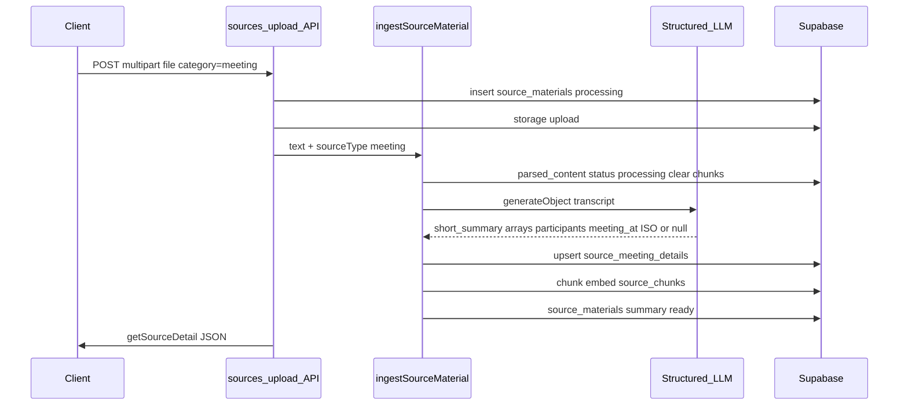

# Meeting transcript ingestion pipeline

## Context

- Upload/replace/retry today all flow through `[src/lib/server/ingestion.ts](src/lib/server/ingestion.ts)`: `[ingestSourceMaterial](src/lib/server/ingestion.ts)` clears chunks, sets `parsed_content`, runs `[generateSourceSummary](src/lib/server/ingestion.ts)` (2–4 sentence doc summary), chunks + embeds, writes `source_chunks`, sets `source_materials.summary`.
- Entry points: `[src/app/api/sources/upload/route.ts](src/app/api/sources/upload/route.ts)`, `[src/app/api/sources/[sourceId]/route.ts](src/app/api/sources/[sourceId]/route.ts)` (PUT), `[src/app/api/sources/[sourceId]/retry/route.ts](src/app/api/sources/[sourceId]/retry/route.ts)`.
- Meetings UI currently derives “insights” heuristically from `summary` / `parsed_content` in `[getMeetingInsights](src/components/sources/sources-panel.tsx)` — no DB-backed detail row yet.
- DB already has `[source_meeting_details](supabase/migrations/20260503_source_input_detail_tables.sql)` with `short_summary`, `decisions`, `action_items`, `risks`, `open_questions` (JSONB arrays), `participants` (JSONB array), and `meeting_at` (**timestamptz**).

## Design decisions

1. **Keep chunking + embeddings for meetings** — The product’s RAG/search path (`source_chunks` + `match_source_chunks`*) stays unchanged. “Replaces generic ingestion” here means **replacing the generic summarizer** for meetings, not removing retrieval.
2. **Single structured model call** — Use AI SDK `generateObject` + Zod to return in one shot: **two-sentence** recap → `short_summary`; **string arrays** (JSONB, default `[]`): `decisions`, `action_items`, `risks`, `open_questions`, **`participants`** (names as in transcript; optional parenthetical role if explicit); **`meeting_at`** as optional ISO-8601 string in the schema (`z.string().nullable()` + validate with `Date.parse` in code is fine). Prompt: infer from title, explicit date lines, headers, meeting platform boilerplate, calendar blocks, or **first cue** timestamp in VTT/SRT; use **`null`** when unreliable—**never invent** a datetime.
3. **Persistence** — Upsert `source_meeting_details`: store `meeting_at` as **timestamptz** only after successful parse; otherwise **`null`**. `participants` as JSONB **string array** like other lists.
4. **Where to store the 2-sentence recap** — Write `short_summary` on `source_meeting_details` **and** set `source_materials.summary` to the same string so list rows (`[SourceListItem](src/components/sources/sources-panel.tsx)` uses `source.summary`) keep working without UI changes.

## Implementation steps

### 1. Meeting extraction in `[src/lib/server/ingestion.ts](src/lib/server/ingestion.ts)`

- Add something like `extractMeetingTranscriptInsights(text: string, title: string)` using `generateObject` + `openai("gpt-5.4-mini")` (consistent with current summarizer). Zod object includes all list fields **plus** `participants` and nullable `meeting_at` string, aligned with design decision 2 (ISO-8601 when confident, else null).
- Truncate transcript for the prompt with a high but safe bound (e.g. first ~24k–48k chars) and document the cap in a one-line comment; ensure **start of file** (metadata, first VTT cues) is included **before** truncation if implementing via “head + tail” concat, so `meeting_at` / participants headers are not dropped—e.g. pass first ~4k chars + remainder budget, or **only** head-heavy truncation for meetings if tail is rarely needed for datetime.
- Extend `ingestSourceMaterial` with a `sourceType: SourceMaterial["type"]` argument (or equivalent). When `sourceType === "meeting"`:
  - After `parsed_content` is set, **skip** `generateSourceSummary`.
  - Run structured extraction; `upsert` into `source_meeting_details` on `source_material_id` (admin client already used in this file), writing **`participants`**, **`meeting_at`** (parsed), and all other fields.
  - Set `summary` on `source_materials` from `short_summary`.
- When `sourceType !== "meeting"`, keep current behavior; optionally `delete().eq("source_material_id", sourceId)` on `source_meeting_details` if type changes (edge case for replace flow when switching category away from meeting — see below).

### 2. Wire callers with explicit type

- `[upload/route.ts](src/app/api/sources/upload/route.ts)`: pass `category` as `sourceType` into `ingestSourceMaterial` (already validated indirectly via insert).
- `[[sourceId]/route.ts](src/app/api/sources/[sourceId]/route.ts)` PUT: pass `category`.
- `[retry/route.ts](src/app/api/sources/[sourceId]/retry/route.ts)`: extend admin `select` to include `type`; pass `source.type` into `ingestSourceMaterial` (today retry ignores type — bug for this feature if unfixed).

### 3. Replace / type-switch cleanup

- On successful PUT in `[[sourceId]/route.ts](src/app/api/sources/[sourceId]/route.ts)`, if the new `category` is **not** `meeting`, delete any `source_meeting_details` row for that `source_material_id` (admin) so stale meeting data does not linger.
- Symmetrically, when switching **to** `meeting`, the new ingest path will upsert details.

### 4. API types and data loading

- Extend `[SourceMaterialDetail](src/lib/types.ts)` with an optional `meeting_details: { short_summary, decisions, action_items, risks, open_questions, participants, meeting_at, ... } | null` (shape aligned with DB, arrays as `unknown`-backed JSON or `string[]` after normalization).
- In `[getSourceDetailsForProject](src/lib/server/data.ts)`: after loading `source_materials`, batch-fetch `source_meeting_details` for rows where `type === "meeting"` (second query with `.in("source_material_id", ids)`), merge into each `SourceMaterialDetail`.
- Extend the materials `.select(...)` if you add `file_kind` later; not required for this task.

### 5. UI: prefer structured insights + meeting meta

- Update `[getMeetingInsights](src/components/sources/sources-panel.tsx)`: if `source.meeting_details` is present, map JSONB arrays to `MeetingInsights`, including **`risks`** (fourth block) and **`participants`** / **`attendees`** (surface as a dedicated list or reuse existing sidebar/meta patterns — today heuristics return `attendees` but the grid does not show them; **add** a Participants section or a compact chip row in the meeting detail header).
- **Meeting date/time**: extend `MeetingInsights` (or the detail header) with `meetingAt: string | null` from `meeting_details.meeting_at`. In the detail header row where `formatDateTime(source.created_at)` appears, **prefer** `meetingAt` when set (“Meeting time · …”) and keep upload/created time secondary if both matter for UX (choose one clear primary label to avoid clutter).
- Keep existing heuristic fallback when `meeting_details` is null (older rows), including heuristic `date` from parsed markdown metadata.

### 6. Activity + librarian

- Optionally tune `[ingestSourceMaterial](src/lib/server/ingestion.ts)` activity `activity_events` summary for meetings (e.g. mention “meeting structured recap”) — minor.
- `[after(triggerOnSourceIngested)](src/app/api/sources/upload/route.ts)` unchanged: librarian still runs after ingest.

## Flow (meetings)

## Files to touch (concise)

| Area          | File                                                                                             |
| ------------- | ------------------------------------------------------------------------------------------------ |
| Core pipeline | `[src/lib/server/ingestion.ts](src/lib/server/ingestion.ts)`                                     |
| Upload        | `[src/app/api/sources/upload/route.ts](src/app/api/sources/upload/route.ts)`                     |
| Replace       | `[src/app/api/sources/[sourceId]/route.ts](src/app/api/sources/[sourceId]/route.ts)`             |
| Retry         | `[src/app/api/sources/[sourceId]/retry/route.ts](src/app/api/sources/[sourceId]/retry/route.ts)` |
| Types         | `[src/lib/types.ts](src/lib/types.ts)`                                                           |
| Loader        | `[src/lib/server/data.ts](src/lib/server/data.ts)`                                               |
| UI            | `[src/components/sources/sources-panel.tsx](src/components/sources/sources-panel.tsx)`           |

## Testing suggestions

- Manual: upload a `.txt` or `.vtt` meeting transcript with `category=meeting`; confirm `source_meeting_details` row populated for lists + **participants** + **`meeting_at`** when inferable, `summary` ≈ two sentences, chunks exist, UI shows risks + participants + meeting time when present.
- Retry a meeting source after editing file in storage path.
- Replace file and switch category from meeting → document; confirm meeting detail row removed.

