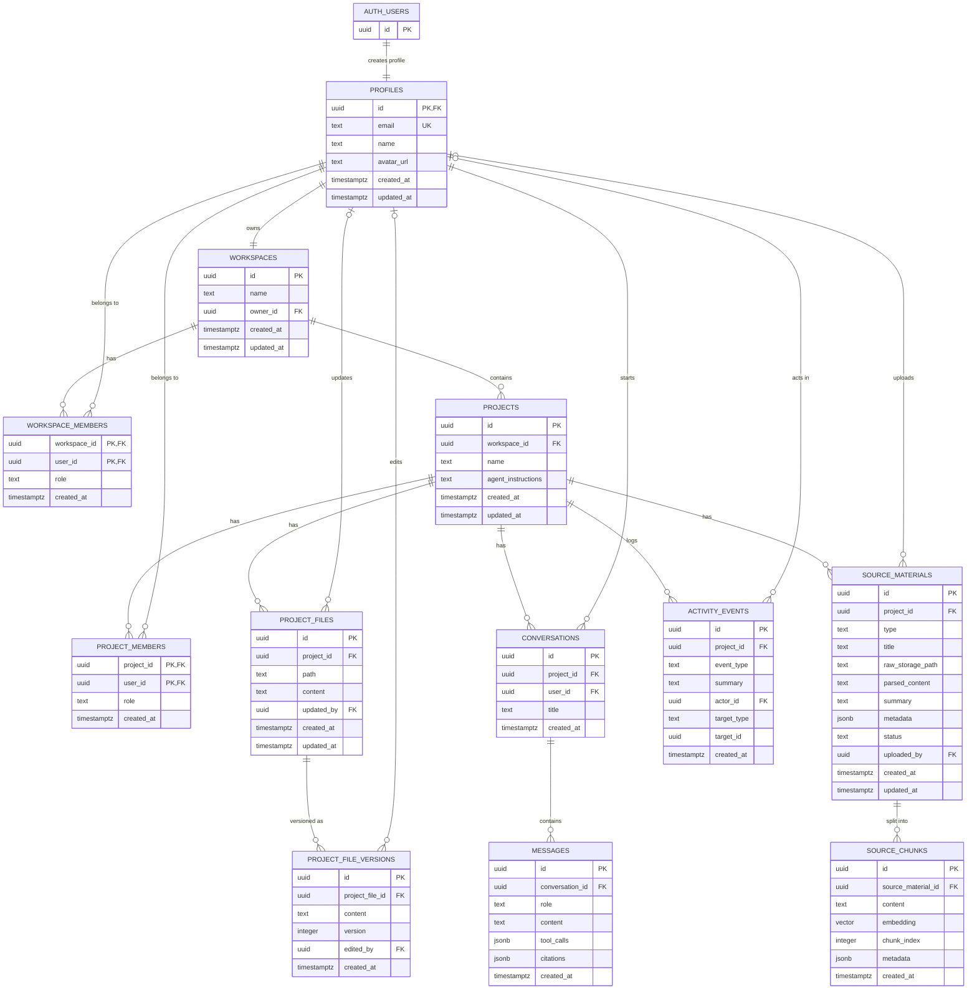

# Supabase Data Model ER Diagram

This diagram is derived from `supabase/migrations/20260408_v1_schema.sql` and verified against the live Supabase project `ai-project-advisor` (`faqtckftiusdgyghwcar`) via the Supabase MCP.

## Notes

- `profiles.id` references `auth.users.id`, and the signup trigger creates or updates the profile and provisions one personal workspace per user.
- `workspaces.owner_id` is unique, so each profile owns exactly one workspace.
- `workspace_members` and `project_members` are join tables with composite primary keys.
- `workspace_members.user_id` is unique so each user has a single owner membership row for app compatibility while the frontend still reads through `workspace_members`.
- `project_files` is unique on `(project_id, path)`.
- `project_file_versions` is unique on `(project_file_id, version)`.
- `source_chunks.embedding` is a `vector(1536)` column indexed for similarity search.
- `activity_events.target_id` is intentionally polymorphic and does not have a foreign key constraint.

