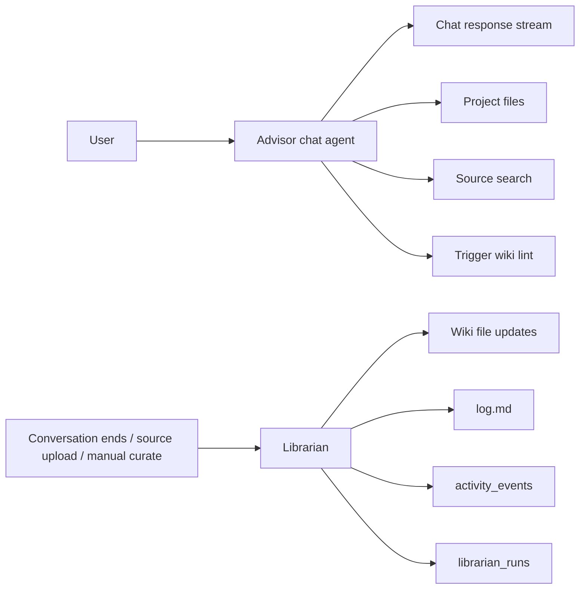
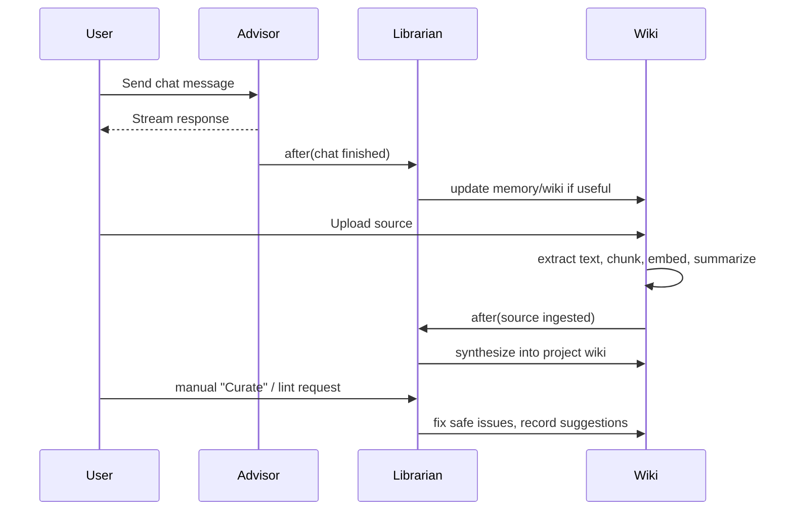

# Agent Architecture

This app currently uses two agents with different jobs:

- `Advisor`: the user-facing chat agent
- `Librarian`: the background wiki-maintenance agent

Both currently run on `gpt-5.4`, but they have different prompts, tools, triggers, and outputs.

## At A Glance

## Agent Comparison

| Aspect           | Advisor                                                                                                                                                                    | Librarian                                                                                                                                          |
| ---------------- | -------------------------------------------------------------------------------------------------------------------------------------------------------------------------- | -------------------------------------------------------------------------------------------------------------------------------------------------- |
| Primary job      | User-facing chat agent                                                                                                                                                     | Background wiki-maintenance agent                                                                                                                  |
| Goal             | Answer the current user request well; help with files and sources; delegate wiki curation                                                                                  | Keep the wiki durable, organized, current, and reusable                                                                                            |
| Main code        | `src/app/api/chat/route.ts` `src/lib/server/chat-context.ts`                                                                                                               | `src/lib/server/librarian/agent.ts` `src/lib/server/librarian/triggers.ts` `src/lib/server/librarian/tools.ts`                                     |
| Runtime style    | Runs per chat request                                                                                                                                                      | Runs as a single autonomous background turn                                                                                                        |
| Model call       | `streamText(...)`                                                                                                                                                          | `generateText(...)`                                                                                                                                |
| User visibility  | Directly visible to the user in chat                                                                                                                                       | Mostly invisible; user sees resulting file changes, `log.md`, and activity                                                                         |
| Main context     | Project name; project settings; current user and role; `index.md`, `log.md`, `glossary.md`, `PROJECT.md`, `WORK.md`, `PRODUCT.md`; latest `memory/*`; current conversation | Project settings; `index.md`; tail of `log.md`; `glossary.md`; one explicit trigger payload                                                        |
| Trigger payloads | Current chat messages                                                                                                                                                      | `source_ingested` = source title/summary/excerpt `conversation_ended` = conversation title/transcript `wiki_lint` = optional user focus            |
| Tools            | `list_files`, `read_file`, `edit_file`, `search_sources`, `read_source`, `trigger_wiki_lint`                                                                               | `list_files`, `read_file`, `create_file`, `edit_file`, `rename_file`, `delete_file`, `search_sources`, `read_source`, `record_suggestion`          |
| Write scope      | Chat replies, conversation history, optional direct file edits                                                                                                             | Wiki file creation/edit/rename/delete, `log.md`, suggestions, run records                                                                          |
| Activity rows    | `agent_file_edit`                                                                                                                                                          | `librarian_file_create`, `librarian_file_edit`, `librarian_file_rename`, `librarian_file_delete`, `librarian_suggestion`, `librarian_run_finished` |
| Run tracking     | Conversation history is saved, but no separate advisor-runs table                                                                                                          | Every run gets a `librarian_runs` row                                                                                                              |
| Triggered by     | User sends a chat request                                                                                                                                                  | Chat completion, starting a new conversation, source upload completion, or manual curate/lint                                                      |
| Modes            | None                                                                                                                                                                       | `write` or `proposal`                                                                                                                              |
| Mode rules       | N/A                                                                                                                                                                        | `wiki_lint` always `write`; `reactive` projects use `proposal`; `source_ingested` uses `proposal` when auto-synthesis is off                       |
| Guardrails       | Viewer cannot edit files; locked files reject edits                                                                                                                        | Locked files cannot be edited/deleted; source-of-truth edits require confirmation; entity-page creation can be disabled; delete is soft-delete     |

## Trigger Paths

### Concrete Trigger Sources

- Chat completion: `src/app/api/chat/route.ts`
- New conversation starts: `src/components/layout/sidebar.tsx` via `src/lib/chat-client.ts`
- Manual curate / lint: `src/app/api/projects/[projectId]/librarian/route.ts`
- Source upload completion: `src/app/api/sources/upload/route.ts`

## Shared Data Surfaces

- `project_files`: wiki and project documents
- `source_materials`: uploaded sources
- `source_chunks`: embeddings-backed search chunks
- `activity_events`: generic activity feed
- `librarian_runs`: one row per Librarian invocation

## Why The Split Exists

- The `Advisor` optimizes for live conversation quality and speed.
- The `Librarian` optimizes for background curation and durable project memory.
- This keeps chat simpler, while still letting the system maintain the wiki after the fact.

## Current Limitation

The backend distinguishes the two agents clearly, but the frontend mostly exposes Librarian work as generic activity events. The architecture is richer than the current UI explanation.